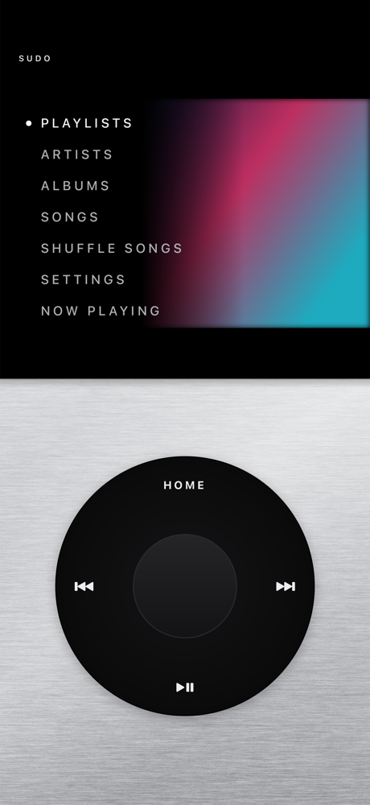
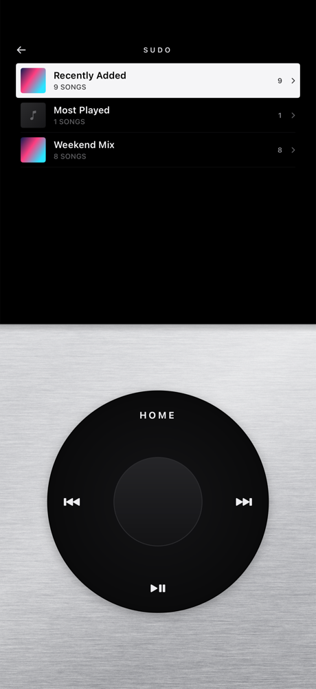
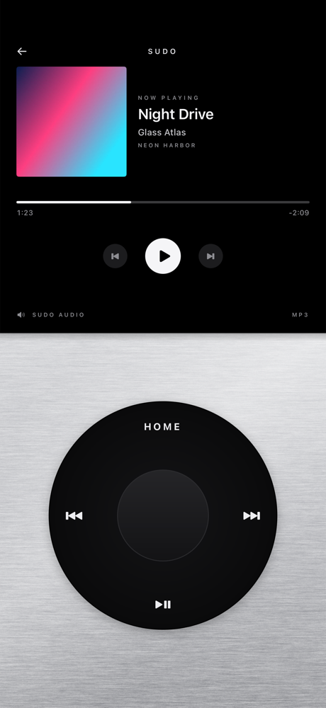
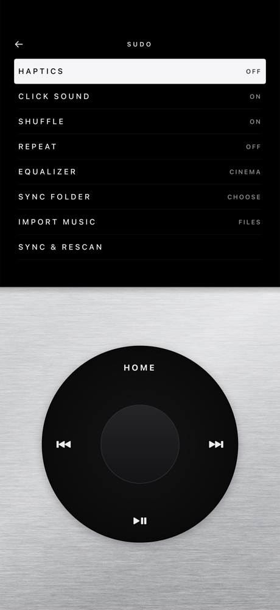

<p align="center">
  <picture>
    <source media="(prefers-color-scheme: dark)" srcset="docs/logo-dark.svg" />
    
  </picture>
</p>

# Haptic Pod

A native iOS music player built around a click wheel. The whole phone screen becomes the device: a black display on top and a scroll wheel below, with Core Haptics ticks and synthesized click sounds as you spin it.

It plays music you own: local files you import from the Files app (Google Drive, iCloud Drive, On My iPhone, and so on).

<p align="center">
  
  
  
  
</p>

<sub>The screenshots use generated demo tracks with made-up artists and gradient cover art.</sub>

## Features

- **Click wheel**: 24 detents per turn, each with a haptic tick and an optional click sound. HOME goes back (hold it to jump to the top menu), ⏮/⏭ skip tracks (hold them to seek), and the centre button selects.
- **Library**: browse by Playlists, Artists, Albums and Songs, or pick Shuffle Songs. Artwork, titles and artists come from the files' own tags.
- **Smart playlists**: Recently Added, Most Played, and one playlist per imported folder.
- **Folder sync**: choose a folder once (for example a Google Drive music folder). New files in it are copied into the library on every launch, and files that are already imported are skipped.
- **Gapless playback** on an `AVAudioEngine` graph.
- **Ten sound modes**: Flat, Stereo, Surround, Cinema, Concert, Club, Bass, Vocal, Treble and Loud. Each mode is a 5-band EQ curve; some also add room reverb and a short ambience delay.
- **Resume**: reopens on the same track and position.
- **Sounds**: 24 built-in sounds for relaxing, meditating and sleeping. Layer up to six of them over your music, set each one's level with the wheel, and set a sleep timer that fades everything out. See [Sounds](#sounds).
- Background audio, lock-screen and Control Center controls.
- Click sounds mix in with other apps' audio instead of stopping it.

## Build

Requirements: Xcode 16 or later (developed with Xcode 27), [XcodeGen](https://github.com/yonaskolb/XcodeGen), and an iPhone running iOS 18 or later.

1. In `project.yml`, set `DEVELOPMENT_TEAM` to your own Apple team ID and change `bundleIdPrefix` / `PRODUCT_BUNDLE_IDENTIFIER` to a prefix you own.
2. Generate the Xcode project, then build:

   ```bash
   xcodegen generate
   open HapticPod.xcodeproj
   ```

   Then run the app on your device from Xcode.

3. In the app, open **Settings › SYNC FOLDER** or **IMPORT MUSIC** and pick your music.

Debug builds accept `-screen songs|playlists|artists|albums|settings|nowPlaying|sounds` as a launch argument to open straight to that screen.

## Sounds

**SOUNDS** on the home menu is an ambient mixer:

- **Recordings:** rain, thunder, ocean, stream, waterfall, forest birds, wind, crickets, frogs,
  campfire, singing bowl, temple gong, wind chimes, a water fountain and an airplane cabin.
- **Generated in code:** white, pink and brown noise, a deep drone, and theta binaural beats.

How to use it:

- Press the centre on a sound to add it.
- Press again to set its level with the wheel. Turning it down to zero removes it.
- **SLEEP TIMER** cycles 15–90 minutes and fades out both the sounds and the music.

Every recording is public domain (CC0) from [Freesound](https://freesound.org). Each file's author
and source are in [`HapticPod/Resources/Sounds/CREDITS.md`](HapticPod/Resources/Sounds/CREDITS.md).
`scripts/prepare_sounds.py` rebuilds the files from the list in `scripts/sounds.tsv`:

- it trims each recording to its steadiest stretch,
- crossfades the ends into a seamless loop,
- and matches loudness to about −24 LUFS.

## Layout

```
HapticPod/
  App/         UIKit app and scene delegates, full-screen hosting controller
  Haptics/     Core Haptics patterns and synthesized click sounds
  Library/     scanning, metadata, artwork cache, import and folder sync
  Models/      tracks, screens and menu items
  Navigation/  wheel-driven navigation stack
  Playback/    AVAudioEngine player, sound modes, Now Playing bridge
  Sounds/      ambient mixer engine, sound catalogue, noise generators, sleep timer
  Resources/   bundled CC0 sound loops and their credits
  Assets.xcassets/  app icon (drawn by scripts/make_icon.swift)
  Views/       device body, display, lists, Now Playing and the wheel
```

No third-party dependencies.
